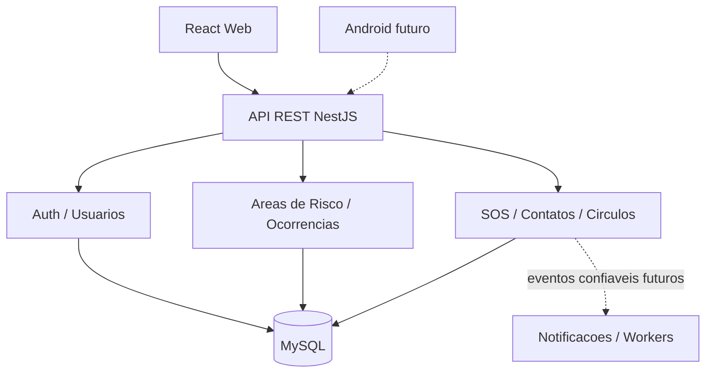
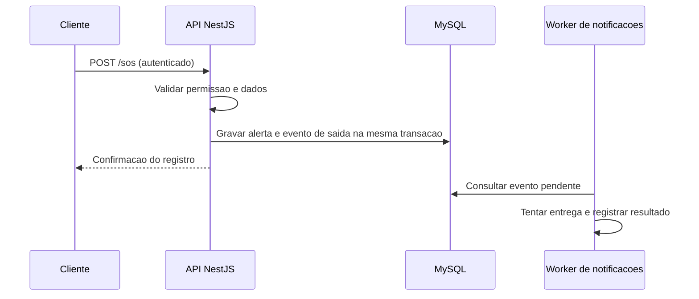

# Arquitetura do Aurora Back-End

> **Status:** proposta arquitetural em discussão; não confundir com estrutura já implementada.

## 1. Objetivos

- Entregar primeiro uma API REST para o React Web.
- Permitir reutilização de regras e recursos por um aplicativo Android no futuro.
- Isolar regras de segurança, ocorrência e localização de frameworks e integrações externas.
- Facilitar testes, manutenção, colaboração e evolução gradual.

## 2. Abordagem escolhida (proposta)

**Monólito modular orientado a domínio**, com princípios de **Clean Architecture / Ports & Adapters**, **SOLID** e **eventos seletivos**. Não adotaremos microsserviços nem Event Sourcing por padrão.



## 3. Responsabilidades das camadas

| Camada | Responsabilidade |
| --- | --- |
| `presentation` | Controllers HTTP, DTOs, autenticação na borda e documentação da API |
| `application` | Casos de uso, orquestração, transações e autorização por ação |
| `domain` | Entidades e regras de negócio sem dependência de NestJS/TypeORM quando justificável |
| `infrastructure` | Repositórios TypeORM, persistência, provedores externos e filas |

A separação será **pragmática**: módulos CRUD simples não precisam de múltiplas abstrações artificiais.

## 4. Estrutura sugerida

```text
src/
  main.ts
  app.module.ts
  config/
  common/
    guards/
    filters/
    interceptors/
    decorators/
  modules/
    auth/
    usuarios/
      presentation/
      application/
      domain/
      infrastructure/
      usuarios.module.ts
    areas-risco/
    ocorrencias/
    contatos-emergencia/
    sos/
    circulos/
    localizacoes/
    notificacoes/
```

**Essa árvore é planejada**, não a estrutura atual do repositório.

## 5. Princípios e padrões

- **SRP:** controllers recebem e respondem; serviços/casos de uso aplicam regras.
- **DIP e Dependency Injection:** módulos dependem de contratos quando isso melhora testabilidade e substituição.
- **Repository:** encapsula consultas e gravações no MySQL.
- **Strategy:** canais alternativos de notificação, quando implementados.
- **Adapter:** APIs externas e hardware sem acoplamento ao domínio.
- **Eventos de domínio:** representam fatos como `SosAtivado`; não são substitutos de transações.
- **CQRS:** somente se consultas/comandos complexos justificarem a separação.

## 6. Fluxo SOS (futuro)



Para eventos críticos, **EventEmitter em memória isoladamente não garante entrega**. Avaliar Transactional Outbox, fila persistente, idempotência, retentativas e monitoramento antes de disponibilizar SOS. A confirmação de gravação **não equivale** à confirmação de recebimento por contatos ou serviços externos.

## 7. Dados, segurança e privacidade

- MySQL com `synchronize: false`; alterações controladas por migrations revisadas.
- Autenticação e autorização por recurso, não apenas por rota.
- Segredos exclusivamente por configuração segura.
- Proteção de localização e histórico; acesso mínimo necessário.
- Definir política de retenção, auditoria, criptografia adequada e resposta a incidentes.
- Aplicar rate limiting e validação de entrada conforme risco.

## 8. Qualidade e operação

- Testes unitários e de integração com **Vitest** (configuração atual).
- Testes E2E para fluxos principais e cenários de falha.
- Swagger/OpenAPI para contratos HTTP (a implementar).
- Logs estruturados, métricas e health checks (a planejar).
- Carga e escala horizontal somente após medir gargalos.

## 9. Pendências arquiteturais

- Confirmar API central única para Web e Android.
- Escolher autenticação própria ou integração com Firebase (o SQL ainda tem `firebase_uid`).
- Definir autorização e regras de acesso a localização, círculos e SOS.
- Definir canal de notificação e garantias de entrega.
- Revisar esquema antes de mapear entidades TypeORM.


## 10.  Autenticação própria com NestJS e JWT, com suporte a Google OpenID Connect.
- Data: 27/10/2026
- Status: substituído
- Contexto: 
- Decisão:
- Alternativas consideradas:
- Consequências:
- Responsáveis:


Ver [DECISOES_TECNICAS.md](DECISOES_TECNICAS.md).
